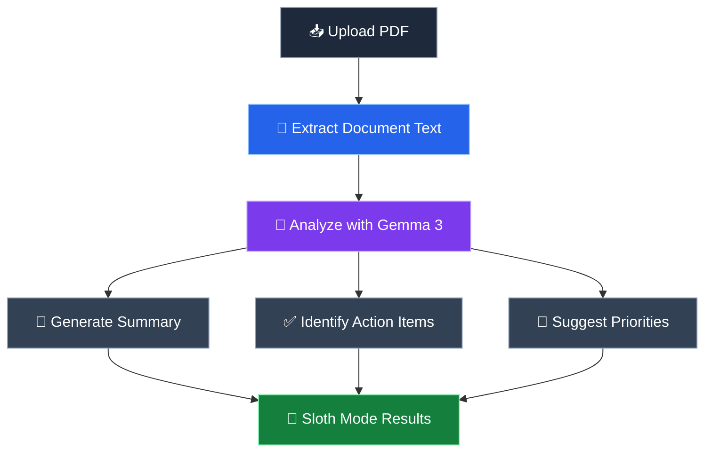
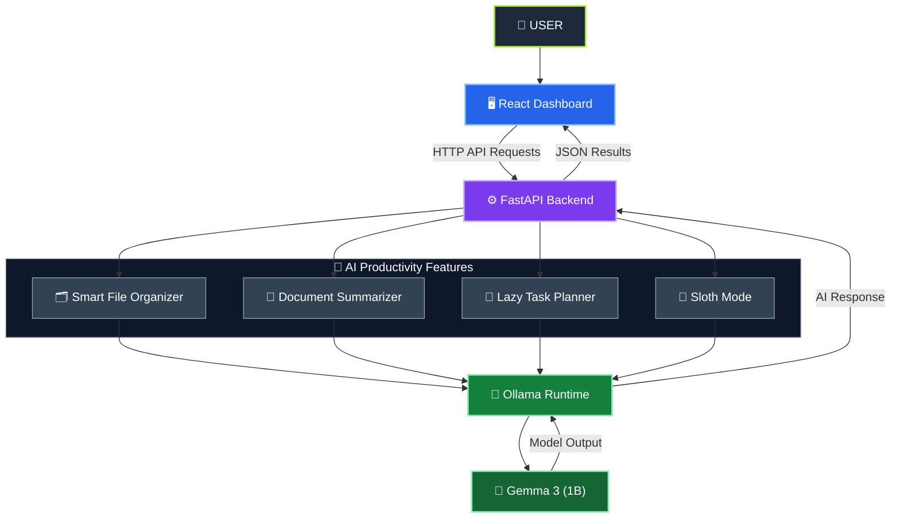

<div align="center">

# 🦥 SlothOS AI

### Work Less. Live More.

**Your Intelligent, Privacy-First Productivity Companion Powered by Local AI**

*Because the smartest way to get things done is to let AI handle the boring stuff.*

### 🏆 Hacktoberfest Week 3 — Slow and Steady

[](https://github.com/sandeepji11/SlothOS-AI)


**[⭐ Star Repository](https://github.com/sandeepji11/SlothOS-AI)** •
**[🐛 Report an Issue](https://github.com/sandeepji11/SlothOS-AI/issues)** •
**[💻 Source Code](https://github.com/sandeepji11/SlothOS-AI)**

---

### 🔒 Privacy First | 🧠 Local AI | ⚡ Smart Automation | 🦥 Effortless Productivity

</div>

---

## 📑 Table of Contents

- [Overview](#-overview)
- [The Problem](#-the-problem)
- [Our Solution](#-our-solution)
- [Key Features](#-key-features)
- [Why Open Innovation Matters](#-why-open-innovation-matters)
- [System Architecture](#️-system-architecture)
- [Technology Stack](#️-technology-stack)
- [Project Structure](#-project-structure)
- [Installation and Setup](#️-installation-and-setup)
- [API Endpoints](#-api-endpoints)
- [Screenshots](#-screenshots)
- [Project Demo](#-project-demo)
- [Hacktoberfest Challenge](#-hacktoberfest-week-3--slow-and-steady)
- [Future Roadmap](#️-future-roadmap)
- [Contributing](#-contributing)
- [Security and Privacy](#-security-and-privacy)
- [Project Creator](#-project-creator)
- [License](#-license)

---

# 🌟 Overview

**SlothOS AI** is a local-first, AI-powered productivity assistant designed to reduce repetitive digital tasks and simplify everyday workflows.

From organizing messy files to summarizing lengthy documents and converting unstructured thoughts into actionable tasks, SlothOS helps users accomplish more with less manual effort.

Unlike traditional cloud-dependent AI assistants, SlothOS uses **Gemma 3 through Ollama**, allowing AI inference to run directly on the user's computer.

The project combines multiple productivity tools into a single modern dashboard.

### 🎯 Our Core Principles

| Principle | Description |
|---|---|
| 🔒 Privacy | AI inference runs locally |
| ⚡ Simplicity | Reduce unnecessary complexity |
| 🦥 Productivity | Automate repetitive digital tasks |
| 🌐 Accessibility | Reduce dependency on cloud AI services |
| 🛠️ Customization | Build on configurable local AI technology |

> **Why spend hours doing repetitive work when your computer can help handle it?**

---

# 🎯 The Problem

Students, developers, and professionals spend valuable time performing repetitive digital tasks.

### Common Challenges

- 📂 Manually organizing downloaded files.
- 📄 Reading lengthy PDFs to extract important information.
- 📝 Converting scattered notes into structured task lists.
- ⏰ Identifying priorities from unorganized information.
- 🔄 Switching between multiple productivity applications.
- 🌐 Depending on internet-based AI tools for routine work.

Although these activities are necessary, they consume time that could be spent learning, creating, or solving meaningful problems.

Many AI solutions also depend on external servers, potentially requiring users to transmit sensitive information to third-party services.

### 💡 The Question

**Can we create an intelligent productivity assistant that reduces repetitive work while keeping AI processing local?**

That question inspired SlothOS AI.

---

# 💡 Our Solution

SlothOS AI brings multiple AI-powered productivity tools into one intuitive application.

Powered by **Gemma 3 (1B)** through **Ollama**, it helps users automate everyday tasks while maintaining greater control over their information.

### 🔄 Our Approach


### 🚀 What Makes SlothOS Different?

- Local AI inference.
- Multiple productivity tools in one dashboard.
- AI-powered document analysis.
- Intelligent file classification.
- Natural-language task planning.
- Reduced dependence on paid cloud AI APIs.
- Privacy-conscious application architecture.

---

# 🚀 Key Features

## 🗂️ 1. Smart File Organizer

### Transform Digital Clutter into an Organized Workspace

SlothOS AI uses local AI to analyze uploaded files and suggest appropriate categories, making file organization faster and easier.

### ✨ Key Capabilities

- 🤖 AI-powered file classification.
- 📂 Organization of uploaded file copies.
- 🔍 Preview suggested categories before applying changes.
- 🔒 Preserve original source files.
- ⚡ Reduce repetitive manual sorting.

### 📥 Before Organization

```text
Downloads/
│
├── 📄 notes.pdf
├── 💻 assignment.py
├── 🖼️ screenshot.png
├── 📄 project_report.pdf
└── 📝 tasks.txt
```

### 📤 After Organization

```text
Organized/
│
├── 📁 Documents/
│   └── 📄 project_report.pdf
│
├── 📁 Study Materials/
│   └── 📄 notes.pdf
│
├── 📁 Programming/
│   └── 💻 assignment.py
│
├── 📁 Images/
│   └── 🖼️ screenshot.png
│
└── 📁 Other/
    └── 📝 tasks.txt
```

> **Note:** The categories shown above are illustrative. Actual classifications depend on AI-generated suggestions.

### 🚀 Benefits

| Feature | Benefit |
|---|---|
| 🤖 AI Classification | Reduces manual file sorting |
| 📂 Smart Categories | Creates a cleaner workspace |
| 🔍 Preview Before Applying | Allows users to review suggestions |
| 🔒 Original File Preservation | Keeps source files unchanged |
| ⚡ Local Processing | Reduces dependency on external services |

---

## 📄 2. AI Document Summarizer

### Turn Long Documents into Useful Insights

The AI Document Summarizer helps users understand lengthy PDF documents without manually reviewing every page.

### ✨ Key Capabilities

- Upload text-based PDF documents.
- Extract text using PyMuPDF.
- Generate AI-powered summaries.
- Highlight important concepts.
- Identify key information.
- Suggest action items when relevant.

### 📥 Example Input

A PDF containing lecture notes, project documentation, or study material.

### 📤 Example Output

```text
DOCUMENT SUMMARY

Overview:
A concise explanation of the document.

KEY POINTS
1. Important concept one
2. Important concept two
3. Important concept three

ACTION ITEMS
- Review important definitions
- Practice related exercises
- Prepare revision notes
```

### 🎯 Benefits

- Faster document understanding.
- Reduced manual reading time.
- Easier identification of important information.
- Useful for students, developers, and professionals.

> **Current Limitation:** Very large PDFs may require future document-chunking support because the prototype limits the amount of text sent to the model.

---

## 🧠 3. Lazy Task Planner

### Turn Messy Thoughts into Structured Plans

The Lazy Task Planner converts unstructured notes into organized tasks with suggested priorities.

### 📥 Example Input

```text
I need to finish my Python assignment,
prepare for my robotics interview,
complete my presentation,
and revise mathematics.
```

### 📤 Example Output

| Task | Suggested Priority |
|---|---|
| Prepare for robotics interview | 🔴 High |
| Complete presentation | 🔴 High |
| Finish Python assignment | 🟡 Medium |
| Revise mathematics | 🟡 Medium |

### ✨ Key Capabilities

- Natural-language task extraction.
- AI-generated task descriptions.
- Suggested task priorities.
- Structured task presentation.
- Simple and intuitive workflow.

### 🎯 Benefits

- Less time spent planning.
- Better task organization.
- Easier prioritization.
- Reduced mental effort.

---

## 🦥 4. Sloth Mode

### One Document. Multiple Useful Insights.

**Sloth Mode** represents the central philosophy of SlothOS AI.

Instead of manually reading a document, identifying important information, and planning the next steps, users can upload a PDF and receive structured AI-generated insights.

### 🔄 Sloth Mode Workflow



### ✨ Generated Insights

1. Concise document summary.
2. Important action items.
3. Suggested priorities.
4. Recommended next steps.

### 🎯 Benefits

- Reduces repetitive document analysis.
- Helps identify actionable information.
- Simplifies planning.
- Combines several useful insights into one workflow.

> **Sloth Mode Philosophy:** Let AI handle repetitive analysis so users can focus on meaningful work.

---

# 🧠 Why Open Innovation Matters

SlothOS AI uses **Gemma 3**, an open-weight language model, through **Ollama**, a local AI inference runtime.

This architecture makes local AI processing a central part of the application.

## 🔓 Why Local AI?

| Feature | SlothOS Local AI | Typical Cloud AI |
|---|---|---|
| Inference Location | User's computer | Remote servers |
| Internet for Inference | Not required after setup | Usually required |
| Document Privacy | Local processing possible | Data may be transmitted |
| Per-Request API Cost | None | May apply |
| Model Configuration | Locally configurable | Provider-dependent |
| Hardware | Uses local resources | Uses remote resources |
| Offline Operation | Supported after setup | Often unavailable |

### 🔒 Privacy

SlothOS can process documents locally without sending their contents to an external AI inference provider.

### 🌐 Offline Functionality

After installing Ollama, downloading Gemma 3, and setting up the application, core AI workflows can operate without an internet connection.

### 🛠️ Customization

Developers can modify prompts, processing logic, workflows, and model configurations.

### 💰 Cost Control

Local inference avoids recurring per-request cloud AI charges, although it still requires local computing resources and electricity.

### 🌍 Open Innovation Philosophy

Open innovation enables developers to experiment with AI systems and build applications that can be customized for real-world needs.

SlothOS demonstrates how local AI can support practical productivity workflows without requiring a proprietary cloud AI API.

> **Important:** Gemma is an open-weight model distributed under its own terms. It is not described here as software released under a conventional open-source license.

---

# 🏗️ System Architecture

## 🧠 How SlothOS AI Works

SlothOS AI follows a modular, local-first architecture combining a React frontend, a Python FastAPI backend, and Gemma 3 through Ollama.

### 📊 Architecture Diagram



### ⚙️ Architecture Components

| Component | Technology | Responsibility |
|---|---|---|
| 🖥️ Frontend | React + Vite | Interactive user interface |
| 🎨 Styling | Tailwind CSS | Responsive dashboard |
| 🔗 API Communication | Axios | HTTP requests |
| ⚙️ Backend | Python + FastAPI | Business logic and API endpoints |
| 📄 PDF Processing | PyMuPDF | Document text extraction |
| 🗂️ File Management | Python | Local file operations |
| 🤖 AI Runtime | Ollama | Local model execution |
| 🧠 AI Model | Gemma 3 (1B) | AI-powered text analysis |

### 🔄 Application Workflow


### 🔒 Local-First AI Processing

SlothOS AI runs Gemma 3 locally through Ollama.

**Advantages:**

- 🔒 **Privacy:** AI inference takes place on the user's computer.
- 🌐 **Offline Capability:** Core AI features can work without internet access after setup.
- 💰 **No Per-Request Cloud AI Fees:** Local inference avoids recurring API charges.
- ⚡ **Direct Integration:** FastAPI communicates with the local Ollama service.
- 🛠️ **Customizable:** Developers can modify prompts and AI workflows.

---

# 🛠️ Technology Stack

| Layer | Technology | Purpose |
|---|---|---|
| Frontend | React | Interactive dashboard |
| Build Tool | Vite | Frontend development |
| Styling | Tailwind CSS | Responsive UI |
| Icons | Lucide React | Interface icons |
| HTTP Client | Axios | API communication |
| Backend | Python | Application logic |
| API Framework | FastAPI | REST API endpoints |
| AI Runtime | Ollama | Local model inference |
| AI Model | Gemma 3 (1B) | AI text processing |
| PDF Processing | PyMuPDF | Extract PDF text |
| File Management | Python pathlib/shutil | Local file operations |
| Version Control | Git | Source control |
| Repository Hosting | GitHub | Code collaboration |

---

# 📂 Project Structure

```text
SlothOS-AI/
│
├── 📁 backend/
│   ├── main.py
│   ├── requirements.txt
│   └── workspace/
│
├── 📁 frontend/
│   ├── 📁 public/
│   │
│   ├── 📁 src/
│   │   ├── App.jsx
│   │   ├── App.css
│   │   ├── index.css
│   │   └── main.jsx
│   │
│   ├── package.json
│   ├── package-lock.json
│   └── vite.config.js
│
├── .gitignore
└── README.md
```

The Python virtual environment, installed Node.js dependencies, and generated workspace files should not be committed to Git.

---

# ⚙️ Installation and Setup

## 📋 Prerequisites

Install the following software:

- Node.js and npm
- Python 3.11 or newer with compatible dependencies
- Git
- Ollama

**Required AI Model:** `gemma3:1b`

---

## 1️⃣ Clone the Repository

Open your terminal and run:

```bash
git clone https://github.com/sandeepji11/SlothOS-AI.git
cd SlothOS-AI
```

---

## 2️⃣ Install Gemma 3

Make sure Ollama is installed.

Download the model:

```bash
ollama pull gemma3:1b
```

Verify installation:

```bash
ollama list
```

You should see `gemma3:1b` among the installed models.

If Ollama is not running, open the Ollama application or start the service:

```bash
ollama serve
```

If Ollama is already running, you do not need to start another instance.

---

## 3️⃣ Set Up the Backend

Navigate to the backend directory:

```bash
cd backend
```

Create a virtual environment:

```bash
python3 -m venv venv
```

Activate the virtual environment on macOS or Linux:

```bash
source venv/bin/activate
```

Install dependencies:

```bash
python -m pip install -r requirements.txt
```

Start FastAPI:

```bash
python -m uvicorn main:app --reload --host 127.0.0.1 --port 8000
```

Expected output:

```text
INFO: Uvicorn running on http://127.0.0.1:8000
INFO: Application startup complete.
```

### Backend Address

`http://127.0.0.1:8000`

### Interactive API Documentation

`http://127.0.0.1:8000/docs`

Keep this terminal running.

---

## 4️⃣ Set Up the Frontend

Open another terminal.

From the project root, navigate to the frontend directory:

```bash
cd frontend
```

Install dependencies:

```bash
npm install
```

Start the frontend development server on port 5175:

```bash
npm run dev -- --port 5175
```

Expected output:

```text
VITE ready

Local: http://localhost:5175/
```

---

## 5️⃣ Launch SlothOS AI

Open your browser and visit:

**http://localhost:5175/**

Make sure the following services are running:

| Service | Address |
|---|---|
| React Frontend | http://localhost:5175 |
| FastAPI Backend | http://127.0.0.1:8000 |
| Ollama | http://localhost:11434 |
| API Documentation | http://127.0.0.1:8000/docs |

The frontend origin must be allowed by the backend's CORS configuration.

When the frontend successfully communicates with the backend and the backend detects Gemma 3, the dashboard should indicate that local AI is ready.

---

# 🔌 API Endpoints

SlothOS uses FastAPI to connect frontend tools to backend functionality.

| Method | Endpoint | Description |
|---|---|---|
| GET | `/` | Backend information |
| GET | `/api/health` | Backend and Ollama status |
| POST | `/api/chat` | Local AI chat |
| POST | `/api/summarize` | PDF summarization |
| POST | `/api/tasks` | Task generation |
| POST | `/api/organize/preview` | File classification preview |
| POST | `/api/organize/apply` | Apply approved organization |
| POST | `/api/sloth-mode` | Document analysis and action items |

### 📚 API Documentation

FastAPI automatically generates interactive API documentation.

Start the backend and open:

`http://127.0.0.1:8000/docs`

> **Note:** Available routes depend on the current backend implementation. Use `/docs` to inspect the endpoints exposed by the running application.

---

# 📸 Screenshots

Application screenshots can be added to this section as the project documentation is updated.

## 🖥️ Main Dashboard

The main dashboard provides access to SlothOS productivity tools and displays the local AI connection status.

## 📄 AI Document Summarizer

The summarizer interface allows users to upload PDF documents and request AI-generated insights.

## 🗂️ Smart File Organizer

The organizer interface classifies uploaded files and previews suggested categories.

## 🧠 Lazy Task Planner

The task planner converts unstructured notes into organized tasks with suggested priorities.

## 🦥 Sloth Mode

Sloth Mode combines document summarization, action-item extraction, and next-step recommendations.

> **Screenshots Coming Soon:** Real screenshots of the working application will be added here.

---

# 🎬 Project Demo

## 🦥 SlothOS AI in Action

**Demo Video:** Coming soon.

**Source Code:** [SlothOS AI GitHub Repository](https://github.com/sandeepji11/SlothOS-AI)

**Project Type:** Local-first AI application.

### 🎥 Planned Demo Highlights

- Launching the SlothOS dashboard.
- Verifying local Gemma 3 inference.
- Summarizing a PDF document.
- Generating tasks from natural-language notes.
- Demonstrating file classification.
- Running Sloth Mode.
- Showing local AI processing through Ollama.

> **Note:** SlothOS currently runs as a local application. The development address is not a publicly hosted demo.

---

# 🏆 Hacktoberfest Week 3 — Slow and Steady

## 🎯 Challenge Theme

**Slow and Steady**

Build something with open-weight models or open-source AI that rewards laziness.

## 🦥 Our Interpretation

Sloths are known for conserving energy and avoiding unnecessary effort.

SlothOS applies the same philosophy to digital productivity.

Instead of requiring users to manually perform every repetitive task, the application helps automate information processing and organization.

### 🌟 How SlothOS Fits the Challenge

| Theme | SlothOS Approach |
|---|---|
| 🐢 Slow | Thoughtful automation over unnecessary complexity |
| 🔄 Steady | Repeatable productivity workflows |
| 🦥 Lazy | Less manual organization and analysis |
| 🔓 Open | Open-weight AI and open-source development tools |
| 💡 Practical | Everyday productivity use cases |
| 🔒 Privacy | Local AI inference |

## 💡 Why This Project Matters

AI productivity should not always require expensive cloud services or external processing of personal information.

SlothOS explores a different approach: local AI that assists with repetitive tasks while giving users more control over their data and workflows.

## 🚀 Our Vision

**Make useful AI productivity tools accessible, customizable, and privacy-conscious.**

---

# 🗺️ Future Roadmap

The following improvements are planned for future development:

- [ ] Export organized files as ZIP archives.
- [ ] Edit suggested categories before applying changes.
- [ ] Add document chunking for large PDFs.
- [ ] Implement persistent task storage.
- [ ] Add semantic document search.
- [ ] Support configurable local AI models.
- [ ] Expand Sloth Mode into multi-step automation.
- [ ] Add activity history.
- [ ] Add productivity analytics.
- [ ] Improve accessibility.
- [ ] Add automated backend tests.
- [ ] Add frontend component tests.
- [ ] Improve error handling.
- [ ] Package SlothOS as a desktop application.

---

# 🤝 Contributing

Contributions, suggestions, and improvements are welcome!

## 🚀 How to Contribute

1. Fork the repository.
2. Create a feature branch.
3. Make your changes.
4. Test your implementation.
5. Commit your changes.
6. Push your branch.
7. Open a pull request.

### Example

Clone the repository:

```bash
git clone https://github.com/sandeepji11/SlothOS-AI.git
cd SlothOS-AI
```

Create a feature branch:

```bash
git checkout -b feature/my-improvement
```

After making changes:

```bash
git add .
git commit -m "feat: describe your improvement"
git push -u origin feature/my-improvement
```

Open a pull request to propose the changes.

### 📋 Contribution Guidelines

- Write readable and maintainable code.
- Follow the existing project structure.
- Test changes before submitting.
- Explain new features clearly.
- Do not commit credentials or personal documents.
- Respect third-party software and model licenses.

For bugs or suggestions:

[🐛 Report an Issue](https://github.com/sandeepji11/SlothOS-AI/issues)

---

# 🔐 Security and Privacy

SlothOS is designed as a local-first productivity application.

## 🔒 Privacy Principles

- AI inference runs through a locally configured Ollama instance.
- Supported documents can be processed locally.
- Local workspace files should remain excluded from Git.
- Users should review AI-generated suggestions.
- Local inference reduces dependency on external AI services.

## 🛡️ Security Considerations

- Do not expose the development API publicly without authentication and appropriate security controls.
- Do not commit API keys or private information.
- Validate uploaded files.
- Keep dependencies updated.
- Review AI-generated results before taking important actions.
- Back up important documents before using file-management tools.

> **Important:** Local inference improves control over data processing, but it does not automatically guarantee complete system security.

---

# 👨‍💻 Project Creator

<div align="center">

## Sandeep Verma

**Developer & Creator of SlothOS AI**

Passionate about artificial intelligence, automation, and building technology that solves real-world problems.

**Project:** SlothOS AI 🦥

**Event:** Hacktoberfest Week 3 — Slow and Steady

**Technology Stack:**

React • Python • FastAPI • Ollama • Gemma 3

### 🌐 Connect With Me

[](https://github.com/sandeepji11)

[](https://github.com/sandeepji11/SlothOS-AI)

</div>

---

# 📜 License

A software license has not yet been specified for this repository.

Until a license is added, the source code remains subject to applicable copyright law.

Third-party dependencies and the Gemma model are governed by their respective licenses and terms.

---

# ⭐ Support the Project

If you find SlothOS AI interesting or useful:

- ⭐ Star the repository.
- 🍴 Fork the project.
- 🐛 Report bugs.
- 💡 Suggest improvements.
- 🤝 Contribute to development.

Your support helps the project grow!

---

<div align="center">

# 🦥 SlothOS AI

### Less Busywork. More Meaningful Work.

**Work Less. Live More.**

*Built with curiosity, open innovation, and a little bit of laziness.*

### 🏆 Hacktoberfest Week 3 — Slow and Steady

Made by **[Sandeep Verma](https://github.com/sandeepji11)**

[](https://github.com/sandeepji11/SlothOS-AI)

</div>